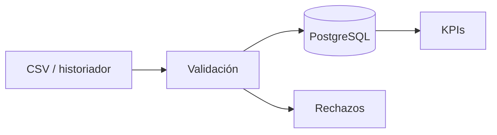

# Semana 8 — Empaque + portfolio: que el repo trabaje para vos

> **Cómo usar esta guía:** es una guía de estudio, no una solución. Los YAML y los comandos están
> como **anatomía comentada**: el workflow que funcione en tu repo lo armás vos, porque depende de
> decisiones que tomaste en las Semanas 6 y 7. El texto orientado a cliente tampoco te lo puede
> escribir nadie: sale de lo que construiste.

## Qué vas a lograr

`industrial-data-pipeline` público, con README que se entiende sin vos al lado, diagrama, CI en
verde corriendo los tests contra un Postgres de verdad, y un `v1.0.0` etiquetado.

Cierra los cinco ítems de Semana 8 en [guia-a-futuro.md](guia-a-futuro.md) y es la semana que
convierte ocho semanas de estudio en algo que se puede mandar por link.

### El cambio de rol

Las siete semanas anteriores el lector eras vos. Esta semana el lector es **alguien que no te
conoce, tiene 90 segundos y está mirando otros cuatro perfiles al mismo tiempo**.

Eso cambia qué es "terminado":

| | Semana 1–7 | Semana 8 |
|---|---|---|
| "Anda" significa | Anda en mi máquina | Anda en una máquina limpia que nunca vio este proyecto |
| El README es | Notas para mí | **El producto**. El código es la evidencia |
| Un test roto es | Deuda que anoto | Una luz roja pública en el repo |
| Escribir en español | Natural | **Una decisión**: ¿tu cliente objetivo lee español? |

> **Sobre el idioma:** todo `PySQLGit-selfcourse` está en español, y eso es coherente para un
> cuaderno de estudio. Para Upwork, el mercado es mayoritariamente en inglés. Salida sensata:
> **README en inglés, código y docstrings como los tengas**. Un repo bilingüe no es un defecto, es
> lo normal. Lo que sí es un defecto es un README en un idioma que tu cliente no lee.

---

## Parte 0 — Los 90 segundos

Lo que pasa cuando alguien abre tu repo, en orden real:

1. **Lee el nombre y la descripción de una línea** (el campo "About", arriba a la derecha — la
   mayoría lo deja vacío y es lo primero que se ve).
2. **Mira los badges.** Verde = alguien se tomó el trabajo. Rojo = se fue.
3. **Lee los primeros dos párrafos del README.** Acá decide si sigue.
4. **Busca el diagrama o una captura.** Si hay, se queda 30 segundos más.
5. **Mira la estructura de carpetas.**
6. **Recién ahí** —y solo si pasó todo lo anterior— abre un archivo de código.

Tu trabajo esta semana es que los pasos 1 a 5 no lo expulsen. El código ya está bien; nadie lo va a
ver si el paso 3 falla.

---

## Parte 1 — El README

### La estructura, en orden de importancia

```markdown
# industrial-data-pipeline
Una línea: QUÉ hace y PARA QUIÉN.
[badges]

[el párrafo del problema: 2-3 líneas]
[el diagrama]

## Quick start          <- lo más arriba posible. Copiar, pegar, funciona.
## Arquitectura
## Estructura del proyecto
## Tests
## Decisiones de diseño
## Licencia
```

### La primera línea es la que más se reescribe

Tiene que decir qué hace y para quién, sin jerga de curso. Comparalo:

| Mal | Por qué |
|---|---|
| "Proyecto capstone del Bloque 3 del roadmap" | El lector no sabe qué es tu roadmap ni le importa |
| "Pipeline de datos en Python" | Cierto y vacío. Hay diez mil |
| "Ingests industrial sensor CSVs into PostgreSQL, validates them, and computes process KPIs" | Qué, de dónde, a dónde, para qué |

**Borrá toda referencia al curso.** "Semana 8", "entregable", "checklist", "ejercicio" — nada de
eso va. No porque haya que mentir, sino porque es información que no le sirve a quien lee y le
cambia el marco de "ingeniero que resuelve un problema" a "alumno que entregó una tarea".

### El Quick start que de verdad funciona

Es la sección que más se prueba y menos se testea. La prueba real: **borrá tu repo local, cloná de
GitHub en otra carpeta y seguí tus propias instrucciones al pie de la letra, sin improvisar.**

Lo que se rompe, siempre lo mismo:

| Rompe | Por qué |
|---|---|
| Rutas absolutas | `E:\Program Files\PostgreSQL18\18\bin` existe solo en tu máquina ([guia-sem4.md](guia-sem4.md), Parte 0) |
| Variables de entorno no documentadas | Vos las tenés seteadas desde hace semanas y ya no las ves |
| La base no existe | El `CREATE DATABASE` está en tu memoria, no en el README |
| Solo PowerShell | Los `.ps1` no corren en macOS ni en Linux. Poné el equivalente `bash` al lado |
| `pip install -r requirements.txt` sin `pip install -e .` | Con `src/` layout, las dependencias solas no alcanzan ([guia-sem6.md](guia-sem6.md), Parte 2) |

**Un `.env.example` y un script de carga de datos de ejemplo resuelven el 80 % de esto.** Ya los
tenés desde Semana 6: usalos en el Quick start.

### La sección que casi nadie escribe y más te distingue

**Decisiones de diseño.** Este repo ya tiene el precedente en [docs/CONCEPTOS.md](docs/CONCEPTOS.md),
y es de lo más valioso que podés mostrar: prueba que elegiste en vez de copiar.

Las que ya tomaste y podés justificar en una línea cada una:

- Por qué PostgreSQL y no SQL Server ([guia-a-futuro.md](guia-a-futuro.md), decisión de arquitectura).
- Por qué tres tablas y no una ([guia-sem4.md](guia-sem4.md), Parte 1).
- Por qué `alarmas` es vista y no tabla.
- Por qué `ON CONFLICT DO NOTHING` en hechos y `DO UPDATE` en configuración.
- Por qué `ddof=0` en todo el pipeline.
- Por qué `src/` layout.
- Qué ganás y qué perdés atándote al dialecto de Postgres.

Ocho líneas. Es la sección más barata de escribir y la que más señal manda.

---

## Parte 2 — El diagrama

### Mermaid, y por qué

GitHub renderiza bloques ` ```mermaid ` **nativamente** en el README. Eso significa: el diagrama
vive en texto, entra en el `git diff`, se edita sin abrir una herramienta, y no hay un `.png` que
se desactualiza en silencio.

~~~markdown

~~~

(Ese `flowchart LR` es la forma mínima de Mermaid: `nodo --> nodo`. `[texto]` es una caja,
`[(texto)]` es un cilindro de base de datos. Con eso solo ya armás el diagrama entero.)

La alternativa —dibujarlo en Excalidraw/draw.io y commitear el `.png`— se ve mejor y envejece peor.
Si elegís esa, **commiteá también el archivo fuente** (`.excalidraw`, `.drawio`) al lado, para
poder editarlo dentro de seis meses.

### Qué tiene que mostrar (y qué no)

| Sí | No |
|---|---|
| Las **fronteras**: ingesta, validación, storage, analítica | Cada función |
| Por dónde entran los datos y dónde terminan | Las clases y su herencia |
| Qué se cae y a dónde va (los rechazos de Semana 6) | El esquema relacional completo |
| Las tecnologías, en el borde de cada caja | Colores decorativos |

**Test del diagrama:** si alguien puede explicar tu pipeline en voz alta mirándolo solo a él, está
bien. Si necesita el README para entenderlo, está de más.

El diagrama de texto de [guia-sem6.md](guia-sem6.md), Parte 1 ya es la estructura correcta — pasalo
a Mermaid y agregale la capa de analítica de Semana 7.

---

## Parte 3 — CI con GitHub Actions

### Anatomía mínima

```yaml
# .github/workflows/tests.yml
name: tests                  # el nombre que aparece en la pestaña Actions
on:                          # CUÁNDO corre
  push:
    branches: [main]
  pull_request:
jobs:
  pytest:                    # un job = una máquina virtual limpia
    runs-on: ubuntu-latest   # <- Linux. Tus .ps1 no existen acá
    steps:
      - uses: actions/checkout@v4          # traer el código
      - uses: actions/setup-python@v5      # instalar Python
        with:
          python-version: "3.12"
          cache: pip                       # <- ahorra ~30 s por corrida
      # TODO: instalar dependencias. Ojo: con src/ layout necesitás también
      #       instalar el paquete, no solo el requirements.txt.
      # TODO: correr pytest.
```

**La idea que hay que tener clara:** cada job arranca en una máquina **vacía**. No tiene tu
Postgres, ni tu `.env`, ni tu PATH arreglado, ni tus datos. Todo lo que tu proyecto necesita para
correr tiene que estar declarado. Por eso el CI es, además de una red de seguridad, **la
verificación más honesta de tu Quick start**: si el workflow anda, tu README es correcto.

### El problema de la base, que es EL problema de esta semana

Tus tests de integración de Semana 7 necesitan Postgres. La máquina del CI no lo tiene.

GitHub Actions permite levantar contenedores auxiliares con `services:`. La anatomía:

```yaml
    services:
      postgres:
        image: postgres:16
        env:
          POSTGRES_PASSWORD: postgres     # efímero: se muere con el job
        ports:
          - 5432:5432
        options: >-
          # TODO: el health check. Pista abajo, y es LA parte que falla.
```

**La trampa que hace perder la tarde:** sin health check, el job arranca los tests **en cuanto el
contenedor existe**, no cuando Postgres está listo para aceptar conexiones. Son unos segundos de
diferencia y el síntoma es el peor posible: **el CI falla a veces**. Verde, rojo, verde, rojo, sin
que hayas tocado nada.

La herramienta se llama `pg_isready` y va en las `options` del servicio, junto con un intervalo,
un timeout y una cantidad de reintentos. Buscá "postgres service container" en la documentación de
Actions: está el bloque exacto. Lo que importa es que entiendas **por qué** está, no que lo copies.

**La segunda trampa:** tu código lee la URL de la base del entorno (Semana 6). En el CI el host no
es `localhost:5432` de tu máquina sino el servicio del job. Eso se resuelve con una `env:` en el
step, no tocando el código. Si para que ande en CI tenés que cambiar el código, la configuración no
estaba bien externalizada.

### Secretos vs variables

| | Cuándo | Cómo |
|---|---|---|
| `env:` en el YAML | Valores que no son secretos: la password de un Postgres efímero que vive 40 segundos | Texto plano en el workflow |
| `${{ secrets.NOMBRE }}` | Credenciales reales: una base externa, un token | Settings → Secrets and variables → Actions |

Poner la password del Postgres del CI en un secret no está mal, pero tampoco aporta: el contenedor
se destruye al terminar el job y no es accesible desde afuera. Lo que **sí** importa: que un fork
de tu repo no pueda leer tus secretos reales — GitHub no se los pasa a los workflows de forks, y
eso a veces confunde cuando un PR externo "falla sin motivo".

### El badge

```markdown

```

Dos trampas chicas:

- El badge muestra **la última corrida de la rama por defecto**. Si tu workflow solo corre en
  `pull_request`, el badge dice "no status" para siempre. Por eso el `on:` de arriba incluye
  `push: branches: [main]`.
- Se puede fijar la rama: `...badge.svg?branch=main`. Útil si trabajás con muchas ramas.

**Un badge rojo es peor que ningún badge.** Si el CI queda rojo, o lo arreglás o sacás el badge —
pero no lo dejes rojo en la portada de tu portfolio.

---

## Parte 4 — El release v1.0.0

### Tag anotado, no ligero

```bash
git tag -a v1.0.0 -m "Primera versión completa: ingesta, validación, storage, KPIs y CI"
```

La `-a` crea un **tag anotado**: es un objeto de git con autor, fecha y mensaje propios. Un tag
ligero (`git tag v1.0.0`, sin `-a`) es solo un puntero a un commit, sin metadatos. Para un release
público va anotado, siempre.

### Los tags no se pushean solos

```bash
git push origin v1.0.0
```

Este es el paso que todo el mundo olvida la primera vez: `git push` a secas **no manda los tags**.
El tag existe en tu máquina, no en GitHub, y no entendés por qué no aparece en la lista de
releases. (`git push --tags` manda todos; preferí el explícito.)

### SemVer, en una línea

`MAYOR.MENOR.PARCHE` — **MAYOR** rompe compatibilidad, **MENOR** agrega funcionalidad sin romper,
**PARCHE** corrige. Empezar en `v1.0.0` es una declaración: "esto está terminado y lo sostengo".
Si preferís `v0.1.0`, también es una declaración legítima ("esto todavía se mueve"). Elegí a
conciencia, como todo lo demás.

### El CHANGELOG

Un `CHANGELOG.md` con una sección por versión y cuatro categorías (`Added`, `Changed`, `Fixed`,
`Removed`) es diez minutos de trabajo. Si venís usando Conventional Commits desde Semana 6
([guia-sem6.md](guia-sem6.md), Parte 7), ya está casi escrito:

```bash
git log --oneline v1.0.0
```

### El Release de GitHub

Desde la pestaña Releases: elegís el tag, ponés título y descripción. La descripción es **para el
mismo lector de los 90 segundos**, no un log técnico: tres viñetas de qué hace el proyecto y una
línea de cómo correrlo.

---

## Parte 5 — La descripción para el cliente

El ítem más incómodo del checklist, y el que más plata mueve.

### El cambio de idioma (no el español/inglés: el otro)

Un cliente de Upwork **no compra tecnología, compra un resultado**. La diferencia:

| Vos escribís | Él lee |
|---|---|
| "Pipeline con SQLAlchemy y window functions" | "no sé si esto me sirve" |
| "Automatiza la carga de exports de sensores a una base consultable, con validación y detección de fuera de rango" | "esto es lo que hago a mano todos los lunes" |

### La estructura de cuatro frases

1. **El problema, en su vocabulario.** "Los datos de planta salen del historiador como CSV y
   terminan en planillas que nadie puede consultar."
2. **Qué hace tu cosa.** "Este pipeline los ingiere, valida y carga en PostgreSQL."
3. **El resultado concreto, con números.** "864 lecturas de 6 sensores procesadas y verificadas;
   detecta 34 excursiones fuera del rango operativo; la carga es idempotente, así que reprocesar un
   día no duplica nada."
4. **El stack, al final y corto.** "Python 3.12, PostgreSQL, SQLAlchemy, pandas, pytest, CI en
   GitHub Actions."

**El número de la frase 3 es lo que la hace creíble.** "Procesa datos de sensores" lo dice
cualquiera; "34 excursiones detectadas sobre 864 lecturas, verificado contra tres implementaciones
independientes" lo dice alguien que lo hizo.

Y eso último es cierto y es tu mejor activo: el mismo dataset lo resolviste con la stdlib, con
pandas y con SQL, y los tres dan idéntico. **Eso es una historia de control de calidad, no de
repetición.** Contala.

### Lo que no va

- Mencionar que es un ejercicio, un curso o un proyecto de práctica.
- Listar tecnologías que tocaste una vez.
- Disculparse ("es un proyecto simple, pero...").
- Prometer lo que el repo no hace (un dashboard que no existe, tiempo real que no hay).

---

## Parte 6 — Higiene antes de hacerlo público

Una vez que el repo es público, el historial también lo es. Repasá esto **antes** de apretar el
botón, no después.

```bash
git log -p -S "password" --all
```

Busca cualquier commit donde la palabra `password` entró o salió del código. Repetí con la password
real, con `PGPASSWORD`, con tu usuario. **Si algo aparece, el problema no se arregla con un commit
nuevo:** hay que reescribir el historial (`git filter-repo`) y, aun así, rotar la credencial —
asumí que quedó expuesta.

El resto del repaso:

```
[] .env NO está en el repo, y nunca estuvo (chequealo en el historial, no solo en el working tree)
[] .env.example SÍ está, con valores falsos
[] LICENSE existe (MIT si no querés pensarlo)
[] La descripción "About" de GitHub está completa, con topics (python, postgresql, etl, data-engineering)
[] No hay rutas absolutas de tu máquina en ningún archivo
[] Los datos de ejemplo están commiteados: alguien puede clonar y correr sin pedirte nada
[] pytest -q en verde en una carpeta recién clonada
[] El CI está en verde en main
[] El README no menciona el curso ni las semanas
```

> **Sobre los datos de ejemplo:** son los mismos CSV de [data/](data/), que se regeneran con
> semilla fija (`scripts/generar_datos.py`). Eso ya es una decisión de calidad que podés contar:
> el dataset de ejemplo es **reproducible**, no un volcado al azar.

---

## Checklist de la semana

```
[] README con propósito, arquitectura, quick start probado desde cero y decisiones de diseño
[] Diagrama de arquitectura (Mermaid en el README)
[] Workflow de GitHub Actions que corre pytest
[] El workflow levanta Postgres como service, con health check
[] Badge de tests en verde en el README
[] Descripción del proyecto orientada a cliente (4 frases, con números)
[] CHANGELOG.md
[] Tag anotado v1.0.0 pusheado + Release en GitHub
[] Repaso de higiene de la Parte 6 completo
[] Clonado en una carpeta limpia y seguido el README al pie de la letra: funciona
```

---

## Lo que NO es esta semana

- **Nada de features nuevas.** La tentación de "le agrego una cosita más antes de publicarlo" es la
  que hace que el proyecto no se publique nunca. Congelá el alcance, empaquetá, publicá. La cosita
  más es `v1.1.0`.
- **Nada de deploy, Docker ni cloud.** No están en el entregable. Un `Dockerfile` a medias en el
  repo resta, no suma.
- **Nada de refactors grandes.** Si algo te da vergüenza, anotalo en un `TODO` o en un issue y
  dejalo documentado. Un repo con issues abiertos y honestos se lee mejor que uno perfecto que
  nadie cree.
- **Nada de esperar a que esté "listo".** Nunca va a estar listo. Va a estar publicado o no va a
  existir.
